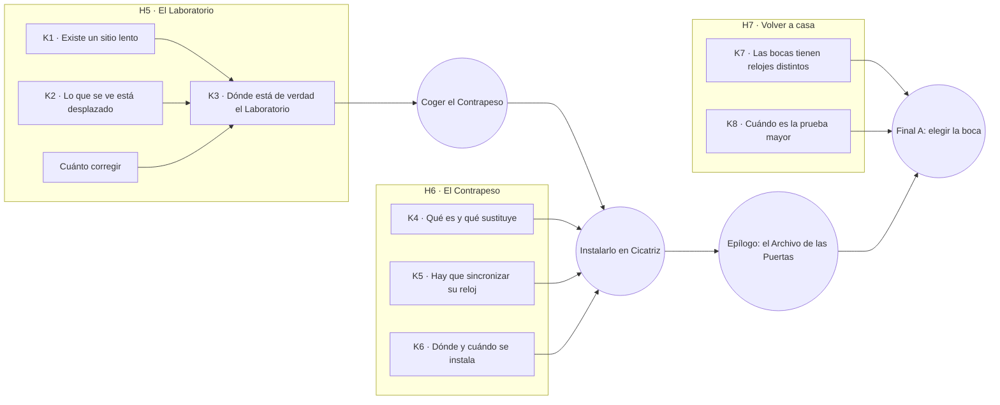

# CONTEXTO DE PISTAS — El grafo del conocimiento

**Versión:** v0.11
**Última actualización:** 2026-11-04 · Fase 11H (Cicatriz hueca: cinco fuentes nuevas)
**Documentos hermanos:** `CONTEXTO_HISTORIA.md` (la verdad y las reglas; léelo primero) y `CONTEXTO_PLANETAS.md` (los lugares)

> Este documento dice **qué se puede aprender, dónde y en qué orden**. Es el puente entre la historia y el
> código del Registro (Fase 4): cada tabla de aquí se convertirá en datos (`pistas.json`) y las reglas de la
> sección 7 se comprobarán con tests.
>
> **Leyenda:** ✅ decidido por Anthony · 🟡 propuesta de Claude, por confirmar · ❓ abierto.
> Todo lo que no lleva marca es 🟡. Los textos completos se escriben más adelante; aquí solo va qué dice cada
> pieza y para qué sirve.

---

## 1. Cómo funciona el conocimiento

Tres piezas (🟡):

| Pieza | Qué es | Ejemplo |
|---|---|---|
| **Fuente** | Algo que se lee, se escucha o se observa en un lugar. En Blender es una marca `INT_` con su `clue_id`, o un evento de la cronología | `umbral.envios`: el registro de envíos del Muelle |
| **Hecho** | Una unidad de conocimiento que entra en el Registro y **persiste entre ciclos** | `lab.existe_lugar_lento`: "Los envíos iban a un destino cuyo reloj apenas avanzaba" |
| **Conclusión** | Lo que el jugador "ya sabe" cuando reúne ciertos hechos. Las conclusiones esenciales abren el camino al final | `K3 · Sé dónde está de verdad el Laboratorio` |

- Un hecho puede estar **en rumor** (alguien lo menciona; el Registro muestra una pregunta) o **descubierto** (se ha visto en su lugar).
- **No hay llaves ni puertas cerradas por conocimiento**: lo que "requiere" una fuente es saber *dónde* o *cuándo* mirar, o *cómo* interpretar lo que se ve. Un jugador muy curioso puede llegar antes; el grafo solo garantiza que **se puede llegar sin suerte**.
- Lo único que bloquea de verdad es **físico y temporal**: un lugar que solo se ilumina un momento, una distancia que no se puede recorrer en un ciclo, el núcleo de la máquina que solo se abre durante el pulso.
- **Lecturas dobles:** casi todas las fuentes tienen una lectura **superficial** (la que se entiende la primera vez) y una **profunda** (la que aparece cuando se sabe más). El Registro guarda la lectura profunda como un hecho aparte que se desbloquea al releer.

---

## 2. Los hilos: las preguntas que se hace el jugador

El Registro se organiza por **hilos** (preguntas), no por mundos. Cada hilo termina en una respuesta.

| Hilo | Pregunta del jugador | Respuesta final (lo que se entiende al cerrarlo) | ¿Esencial para el final A? |
|---|---|---|---|
| **H1 · El bucle** | ¿Por qué vuelvo a despertar frente a La Boca? | La Cámara de los Ausentes sostiene los últimos 15 minutos usando el instante del colapso; sigue sola desde que ellos se fueron | No (da sentido) |
| **H2 · La deuda** | ¿Qué causa el agujero negro? | Cada uso de una Puerta separa sus dos relojes; al pasar el Límite colapsa. La red contagia el colapso a todas | Sí (para entender el Contrapeso) |
| **H3 · La Gran Partida** | ¿Qué les pasó a los Ausentes? | Murieron huyendo por las mismas Puertas que los condenaban; la evacuación aceleró la cascada | No (núcleo emocional) |
| **H4 · El silencio** | ¿Por qué nadie lo detuvo? | El Consejo ocultó el peligro; la investigadora y el escéptico trabajaron en secreto | No (núcleo moral) |
| **H5 · El Laboratorio** | ¿Dónde investigaban de verdad? | En el Sitio Lento, escondido tras la lente del Nudo: lo que se ve en el cielo está desplazado | **Sí** |
| **H6 · El Contrapeso** | ¿Cómo se detiene? | Sustituir el motor de la máquina de Cicatriz por el Contrapeso, con su reloj sincronizado, durante el pulso | **Sí** |
| **H7 · Volver a casa** | ¿Cómo y cuándo vuelvo? | Las bocas tienen relojes distintos; hay que salir por la que llega antes de la prueba mayor del Instituto | **Sí** (epílogo) |

---

## 3. El Nudo (✅ Anthony, 2026-10-25)

La lente gravitacional (✅) y el tiempo lentísimo del Laboratorio (ritmo 0,20) necesitan **una masa enorme y
compacta** cerca del Laboratorio. Antes del minuto 13:30 todavía no hay agujero negro, así que propongo:

- **El Nudo:** la garganta de la **primera Puerta**, que se cerró mal hace generaciones. La deuda acumulada se
  quedó ahí, comprimida en un punto oscuro, diminuto y pesadísimo. Es la **semilla** del agujero negro: a las
  13:30 el Nudo "despierta" y nace el colapso.
- **El Laboratorio orbita muy cerca del Nudo** para estudiarlo. Por eso su tiempo va 5 veces más lento y por eso
  su imagen llega desplazada (la luz rodea el Nudo).
- Une piezas que ya existen: la Primera Puerta en ruinas de Cicatriz, el "primer colapso" que el Consejo
  encubrió, y por qué la investigación estaba justo allí.
- ✅ (Anthony, 2026-10-28) **El Laboratorio está dentro del Nudo**, con la gravedad invertida (ver
  `CONTEXTO_PLANETAS.md` §8). 🟡 Por eso su tiempo va tan lento y por eso no se ve donde está: la luz que escapa
  del Nudo sale curvada y su imagen aparece desplazada hacia la Brasa (la regla de la lente, Fase 7).

---

## 4. El camino al final A: conclusiones esenciales

Cada conclusión necesita hechos que se pueden obtener **por al menos dos fuentes de mundos distintos**.
Ninguna depende de una sola ruta. (En `[ ]` el número de fuentes que la alimentan.)

| Conclusión | Qué hace falta saber | Fuentes (mundo) |
|---|---|---|
| **K1 · Existe un sitio lento** [6] | Que había un destino secreto cuyo reloj apenas avanzaba | `umbral.envios` (Umbral) · `umbral.carta` (Umbral) · `archivo.sala_relojes` (Archivo) · `archivo.escritorio` (Archivo) · `taller.cabina` (Taller) · `cicatriz.grabacion_esceptico` (Cicatriz) |
| **K2 · Lo que se ve está desplazado** [3] | Que cerca del Nudo la luz se dobla y la imagen del Sitio Lento no está donde parece | `archivo.ranura_luz` (Archivo) · `observatorio.telescopio` (Observatorio, opcional) · `cicatriz.borde` (Cicatriz) |
| **Cuánto corregir** [2] | Hacia dónde y cuánto mover la imagen para encontrar la posición real | `cicatriz.grabacion_esceptico` (Cicatriz) · `taller.cabina` (Taller) |
| **K3 · Dónde está el Laboratorio** | K1 **y** K2 **y** cuánto corregir | Conclusión: con eso se puede volar hasta él (Fase 5) |
| **K4 · Qué es el Contrapeso** [4] | Un motor de reemplazo que "paga" la deuda; se pone en lugar del motor de la máquina | `taller.manual` (Taller) · `taller.secuencia` (Taller, evento 7:00) · `lab.notas_investigadora` (Laboratorio) · `instituto.informe_deuda` (prólogo, lectura profunda) |
| **K5 · Hay que sincronizar su reloj** [4] | Que su reloj interno debe coincidir con el de la máquina; viajar entre mundos lo desfasa y hay que corregirlo | `taller.nota_cuna` (Taller) · `taller.gemelos` (Taller, el método) · `lab.pizarra` (Laboratorio, la cuenta) · `archivo.sala_relojes` (Archivo) |
| **K6 · Dónde y cuándo se instala** [3] | En la Sala del Motor de Cicatriz, mientras el núcleo está abierto durante el pulso (9:00) | `cicatriz.sala_motor` (Cicatriz) · `taller.secuencia` (Taller) · `cicatriz.bitacora` (Cicatriz) |
| **K7 · Las bocas tienen relojes distintos** [4] | Que cada boca de una Puerta lleva su propio tiempo, y por eso las cosas llegan "de épocas distintas" | `instituto.fragmento_luna` (prólogo, lectura profunda) · `archivo.cartas` (Archivo) · `cicatriz.lista_mundos` (Cicatriz) · `umbral.cuaderno` (Umbral) |
| **K8 · Cuándo es la prueba mayor** [3] | Cuánto falta, en el reloj de casa, para la prueba que lo condena todo | `instituto.mesa_puerta` (prólogo) · `cicatriz.bitacora` (Cicatriz: una boca nueva "llama") · `lab.notas_investigadora` (Laboratorio: "un sistema joven ha empezado a llamar") |

**El Observatorio** (✅ existe, opcional): K2 tiene dos fuentes sin él (Archivo y Cicatriz). El grafo no depende
de él.

---

## 5. Fuentes por lugar

Columnas: **id** (`clue_id` de la marca en Blender) · **tipo** (texto, grabación, objeto, observación, evento) ·
**cuándo** (siempre o ventana del ciclo) · **lectura superficial** · **lectura profunda** (al saber más) ·
**hechos** que da · **hilos**.

### 5.1 Prólogo: el Instituto y la Luna (casa)

En casa se lee con calma y sin bucle. Casi todo tiene **lectura doble**: aquí parece curiosidad científica y al
final se entiende como aviso.

| id | Tipo | Superficial | Profunda (se desbloquea con…) | Hilos |
|---|---|---|---|---|
| `instituto.ficha` | Texto (tutorial de lectura) | Una lista de turnos de riego de los Ausentes: vida cotidiana | Al lado de cada turno, "y luego la Puerta": cruzaban las Puertas a diario, como quien toma un tren (con H2) | H2, H3 |
| `instituto.vitrina_bordes` | Objeto | Los fragmentos tienen bordes lisos y curvos; el Instituto no sabe por qué | Son cortes de micro gusanos: "mordidas" del espacio (con `cicatriz.mordidas`) | H2 |
| `instituto.simbolo_partido` | Objeto | Medio símbolo tallado, sin significado conocido | Es la mitad de la pared de una Mordida de Cicatriz: este fragmento salió de allí (con `cicatriz.mordidas`) | H2, H7 |
| `instituto.informe_deuda` | Texto (incompleto) | "Cada paso deja una deuda que…" — el resto ilegible; el Instituto lo interpreta como un coste de energía | La deuda es de **tiempo** (con K4 o H2 completo) | H2, H6 |
| `instituto.mesa_puerta` | Objeto + diálogo | Un anillo del tamaño de la mano; "pruebas menores"; la prueba mayor "dentro de N días" | Están construyendo una Puerta sin el estabilizador que nunca llegó; esos N días son el plazo del final A (K8) | H7 |
| `instituto.directora` | Diálogo | La misión: ir a la Luna a estudiar el fragmento más grande | Ella dirige la prueba y es quien más la quiere (a quien hay que convencer en el final A) | H7 |
| `instituto.fragmento_luna` | Objeto (Luna) | El fragmento más grande, con su fecha tallada: es **más antiguo** que los que llegaron antes | Las bocas tienen relojes distintos: llegó después pero viene de antes (K7) | H7 |

### 5.2 Umbral — la llegada (reloj 1,00)

| id | Tipo | Cuándo | Superficial | Profunda | Hechos · Hilos |
|---|---|---|---|---|---|
| `umbral.boca` | Observación | Siempre (al despertar) | Un anillo apagado con una grieta de luz que se cierra a tu espalda | La grieta es la Cámara "cosiendo" el ciclo (con H1) | `bucle.llegada` · H1 |
| `umbral.placa` | Texto | Siempre | Inauguración de La Boca: orgullo y celebración | Detalle fuera de tono: "con la venia del Consejo de Tránsito, la cuenta empieza hoy" | `silencio.consejo_existe`, `deuda.palabra` · H2, H4 |
| `umbral.cuaderno` | Texto (puzzle) | Siempre | Un turno anotaba la hora de Umbral y la del Archivo; las columnas se separan poco a poco | Enseña a comparar relojes: la herramienta de todo el juego | `deuda.relojes_se_separan` · H2, H7 |
| `umbral.envios` | Texto | Siempre | Registro de envíos a un destino sin nombre en ningún mapa | Los acuses de recibo de ese destino llegan con fechas que casi no avanzan: allí el tiempo va lentísimo (K1) | `lab.existe_lugar_lento` · H5 |
| `umbral.carta` | Texto | Siempre | Una carta sin enviar en el Mirador: alguien esperaba a alguien | "Me escribes que para ti ha pasado una semana; aquí han pasado meses" (K1). Esperaba a la investigadora | `lab.existe_lugar_lento`, `silencio.investigadora` · H4, H5 |
| `umbral.aula` | Texto | Siempre | Inscripciones infantiles: números y la forma de escribir horas | Una canción de cuna: "no cruces dos veces la misma Puerta en el mismo día" (H2) | `lectura.horas`, `deuda.cancion` · H2 |
| `umbral.casas` | Objeto | Siempre | Seis casas con las mesas servidas, sin violencia | El aviso de evacuación pegado en una puerta: "40 minutos, Puertas 2 a 6" | `partida.evacuacion` · H3 |
| `umbral.destello` | Evento (`TRIG_LaBoca_Destello`) | 10:00, 3 s | La Boca se abre un instante; su luz se ve desde otros mundos | Las Puertas "se buscan": La Boca responde a una llamada lejana (la de casa) | `deuda.puertas_se_buscan` · H2, H7 |
| `umbral.hoja_entrada` (🟡, Fase 11E) | Texto | Siempre | Una hoja suelta del registro en el tablón del Muelle: las cargas al Archivo no entraban por el vidrio | "Bajo la tercera torre, en el fondo, la puerta del pozo. Busca las tres bandas" | `archivo.entrada` · H4 |

### 5.3 Archivo — la biblioteca (reloj 0,80)

> **Fase 11 (✅ Anthony, 2026-11-03):** la entrada a la cúpula del Archivo solo se encuentra con una pista leída en otro planeta. La fuente está en el Muelle de Envíos (✅ el sitio): `umbral.hoja_entrada` da el hecho `archivo.entrada` (🟡, hilo H4), y nada del Archivo hace falta para conseguirlo. No es un hecho esencial, porque la esclusa se puede encontrar buceando sin la pista.

| id | Tipo | Cuándo | Superficial | Profunda | Hechos · Hilos |
|---|---|---|---|---|---|
| `archivo.informe_oficial` | Texto | Siempre | Informe del Consejo: "incidentes aislados en Puertas lejanas, sin riesgo" | Es la versión que tapó los primeros colapsos (con H4) | `silencio.version_oficial` · H3, H4 |
| `archivo.indice` | Texto | Siempre | Un muro de registros con tres columnas vacías | El hueco es el mensaje: alrededor se lee "Deuda — ver Sala Cerrada" | `silencio.censura` · H4 |
| `archivo.sala_relojes` | Observación | Siempre | Decenas de relojes, cada uno con la etiqueta de dónde se calibró | Uno, sin nombre de mundo, avanza unas 5 veces más lento que el de Umbral (K1, K5: así se mide un desfase) | `lab.existe_lugar_lento`, `contrapeso.medir_desfase` · H5, H6 |
| `archivo.cartas` | Texto (puzzle principal) | Siempre | Cartas que contestan antes de haber sido enviadas | Escritas en relojes distintos; reordenadas, muestran que el informe de la investigadora se archivó tres veces y algo se borró cada vez (K7, H4) | `bocas.relojes_distintos`, `silencio.borrado` · H4, H7 |
| `archivo.escritorio` | Texto | Siempre | Notas del archivista, que veía cosas que no cuadraban | "Faltan cuarenta días que no recuerdo haber archivado": alguien vivía en otro tiempo (K1) | `lab.existe_lugar_lento` · H5 |
| `archivo.ranura_luz` | Texto (solo legible con la luz) | 4:00–5:30 | Una tablilla de astronomía que la luz de la Brasa ilumina un momento | Un mapa del cielo: "cerca del Nudo, las estrellas se ven donde no están" (K2) | `lab.imagen_desplazada`, `nudo.existe` · H5 |
| `archivo.fondo_canon` | Texto | ❓ un momento del ciclo | Registros "cerrados" en la zona oscura | Actas del Consejo: "se aprueba no comunicar" y la orden de construir un aparato que "sostenga el último cuarto de hora" (H1, H4) | `silencio.acta`, `bucle.orden_camara` · H1, H4 |

### 5.4 Taller — la fábrica sin gente (reloj 0,85, órbita rapidísima)

| id | Tipo | Cuándo | Superficial | Profunda | Hechos · Hilos |
|---|---|---|---|---|---|
| `taller.montaje` | Observación | Siempre | Brazos mecánicos que siguen montando anillos para nadie | Aquí se fabricaban las Puertas: eran su economía y su orgullo (H4: por qué callaron) | `silencio.economia` · H4 |
| `taller.cuna` | Objeto | Siempre | Un pedestal vacío con cables; placa "trasladado para las pruebas finales" | Se lo llevaron al sitio de las pruebas: el Sitio Lento (H5) | `contrapeso.trasladado` · H5, H6 |
| `taller.nota_cuna` | Texto | Siempre | "No lo muevan sin ajustar el reloj" | Su reloj interno importa (K5) | `contrapeso.reloj` · H6 |
| `taller.manual` | Texto (incompleto) | Siempre | Manual de instalación del Contrapeso; faltan las páginas de sincronización | Qué es y qué sustituye: el motor de la máquina (K4); lo que falta está en el Laboratorio (`lab.pizarra`) y, desde la Fase 11F (🟡), también en el centro del Taller (`taller.paginas`) | `contrapeso.que_es`, `contrapeso.sustituye_motor` · H6 |
| `taller.gemelos` | Texto (puzzle) | Siempre | Dos diarios de los mismos tres meses (un técnico aquí, su hermana en Umbral) con cifras que no cuadran | Dilatación por velocidad; el método para calcular cuánto se desfasa un reloj al viajar (K5) | `contrapeso.metodo_sincronia` · H2, H6 |
| `taller.cabina` | Observación | Siempre | Consola con el reloj del Taller frente al de otros mundos | Hay una línea para un destino sin nombre (ritmo 0,20) y su ventana de transferencia: hacia dónde girar la imagen (K1, corrección) | `lab.existe_lugar_lento`, `lab.correccion` · H5 |
| `taller.secuencia` | Evento | 7:00, 2 min | Toda la fábrica se pone en marcha | Una simulación automática de cómo se instalaba el Contrapeso: abrir el núcleo durante el pulso, sacar el motor, encajar el Contrapeso (K4, K6) | `contrapeso.que_es`, `contrapeso.ventana_pulso` · H6 |
| `taller.pista` 🟡 | Observación (puzzle) | Siempre | El reloj de la Pista de Pruebas, desajustado, con dos ruedas | Ajustarlo a la hora del Taller enseña a comparar relojes de sitios distintos; con él en hora, el anillo de la Pista se abre a las 7:00 (Fase 11F) | `contrapeso.medir_desfase` · H6 |
| `taller.paginas` 🟡 | Texto | Sala del Centro (por el anillo de la Pista) | Las páginas de sincronización que faltan en el manual | La cuenta para corregir el reloj del Contrapeso según la ruta (K5); segunda fuente de la cuenta, con `lab.pizarra` (✅ opción B, Fase 11F) | `contrapeso.cuenta_sincronia` · H6 |
| `taller.dormitorios` | Texto | Siempre | Literas y objetos personales | El técnico nombra a la investigadora y al escéptico: "se fueron al sitio lento y no volvieron a escribir" | `silencio.dos_investigadores` · H4, H5 |

### 5.5 Cicatriz — el origen (reloj 0,60 y bajando)

| id | Tipo | Cuándo | Superficial | Profunda | Hechos · Hilos |
|---|---|---|---|---|---|
| `cicatriz.sala_motor` | Objeto | Siempre (el núcleo solo se abre en el pulso) | Un anillo enorme con el núcleo cerrado; dentro, el motor viejo | Aquí se instala el Contrapeso; el núcleo se abre a las 9:00 (K6) | `contrapeso.lugar`, `contrapeso.ventana_pulso` · H6 |
| `cicatriz.mordidas` | Observación | Siempre | Decenas de cortes esféricos perfectos | Una pared con medio símbolo que encaja con el del Instituto: los fragmentos de casa salieron de aquí | `deuda.filtraciones`, `casa.fragmentos_de_aqui` · H2, H7 |
| `cicatriz.grabacion_esceptico` | Grabación | Siempre | Una grabación que suena lentísima e incomprensible | Grabada con un reloj 5 veces más lento: reproducida a ese ritmo se entiende. Advierte del Límite y describe desde dónde graba: dentro del Nudo, y que su luz sale torcida hacia la Brasa, así que hay que apartar la vista de ella para dar con el sitio (K1, corrección, H4) | `lab.existe_lugar_lento`, `lab.correccion`, `silencio.advertencia` · H4, H5 |
| `cicatriz.bitacora` | Texto | Siempre | Bitácora de la máquina con picos en cada uso | Los picos se disparan durante la evacuación (H3); la última entrada: "una boca nueva llama desde un sistema joven" con su cuenta (K8); el núcleo solo se abre en el pulso (K6) | `partida.cascada`, `casa.prueba_llama`, `contrapeso.ventana_pulso` · H3, H6, H7 |
| `cicatriz.lista_mundos` | Texto | Siempre | La lista de mundos conectados a la red, con huecos | Cada boca tiene su hora anotada y no coinciden (K7); un hueco lleva el símbolo del sistema del protagonista | `bocas.relojes_distintos`, `casa.en_la_red` · H2, H7 |
| `cicatriz.primera_puerta` | Observación | Siempre | Ruina del primer anillo | Su garganta se cerró mal: ahí empezó el Nudo (sección 3) | `nudo.origen` · H2, H5 |
| `cicatriz.borde` | Observación | Siempre; más fuerte cerca de 13:30 | Un acantilado frente al cielo | Las estrellas se deforman alrededor de un punto oscuro: el Nudo dobla la luz (K2); a las 13:30 nace el agujero negro | `lab.imagen_desplazada`, `nudo.existe` · H2, H5 |
| `cicatriz.palanca` 🟡 | Objeto | Antes del pulso (9:00) | La palanca que saca el motor viejo del núcleo ("E · tirar") | — | `contrapeso.sustituye_motor` · H6 |
| `cicatriz.cuna` 🟡 | Objeto (lector `ruedas`) | Siempre; se usa con el Contrapeso | La cuna frente al núcleo, con dos ruedas (minutos y segundos) y el reloj de la máquina al lado del suyo | Igualar los dos relojes: lo que pide el pulso para encajarlo (K5, se anota al igualarlos) | `contrapeso.reloj` · H6 |
| `cicatriz.cripta` 🟡 | Texto | Siempre | La Cripta de la Garganta, bajo la explanada de la Primera Puerta: un tapón de anillos y una inscripción | La primera garganta no se pudo cerrar: la sellaron, la plegaron y la mandaron lejos (requiere `nudo.origen`) | `nudo.sellado` → `nudo.existe` · H2, H5 |
| `cicatriz.friso` 🟡 | Texto | Siempre | El Friso de la Excavación, en la cara interior: figuras sacando roca del centro en anillos | Cada anillo forjado es una Puerta y cada Puerta deja una mordida (requiere `deuda.filtraciones`) | `deuda.mundo_vaciado` → `deuda.coste_energia` · H2, H4 |
| `cicatriz.nucleo` 🟡 | Observación | Siempre | Desde el visor de la banda, el micro agujero del centro con su aro de luz | Es como el Nudo, pero diminuto y despierto; la máquina lo rodea para que no crezca (requiere `nudo.existe`) | `deuda.garganta_maquina` · H2 |
| `cicatriz.partidas` 🟡 | Texto | Siempre | El tablero de la Sala de Partidas, casi todo tachado | Las últimas salidas, a mano; la última sin destino (requiere `partida.evacuacion`) | `partida.ultimas_salidas` → `partida.cascada` · H3 |
| `cicatriz.anillo` 🟡 | Texto | Siempre | La placa del Faro, en un fragmento del anillo | El anillo es la roca que las mordidas arrancaron y no se llevaron (requiere `casa.fragmentos_de_aqui`) | `deuda.anillo_de_mordidas` · H2 |

### 5.6 Observatorio — el cielo limpio (reloj 1,15; ✅ existe, opcional)

| id | Tipo | Cuándo | Superficial | Profunda | Hechos · Hilos |
|---|---|---|---|---|---|
| `observatorio.libro` | Texto | Siempre | Libro de turnos: "señal sin confirmar" cada día durante años | Esa señal era el Sitio Lento, visto donde no está | `lab.imagen_desplazada` · H5 |
| `observatorio.telescopio` | Observación | 6:30, 1 min (alineación) | Un punto que no se mueve como una estrella | Es la imagen desplazada del Laboratorio (K2) | `lab.imagen_desplazada` · H5 |
| `observatorio.informe` | Texto | Siempre | "Desde fuera todo parecía en calma" | Mientras tanto, los colapsos ya habían empezado (H4) | `silencio.calma_aparente` · H4 |

🟡 **Propuesta (2026-11-05):** el telescopio se puede usar siempre (lector `ocular`, el cielo en vivo); solo durante la
alineación de las 6:30 se ve limpia la imagen y el anillo de estrellas, así que el hecho sigue dándose solo entonces.
Además hay cinco fuentes de ambiente (fuera del grafo, sin hechos) que cuentan el lugar: `observatorio.registrador`
(el tambor que registra las fluctuaciones), `observatorio.placas` (una placa por noche, el punto que no se mueve),
`observatorio.relojes` («Umbral» y «Aquí», que se separan), `observatorio.carta` (el Consejo ordena no enviar las
mediciones) y `observatorio.relevo` (el registro del hangar; el último relevo «no trae papel»). Textos en borrador.

### 5.7 Laboratorio Oculto — el Sitio Lento (reloj 0,20)

Llegar aquí cuesta casi un ciclo entero (modo B ✅): cada minuto real son cinco de fuera. Lo que se lee aquí
**cierra** hilos, no los abre.

| id | Tipo | Superficial | Profunda | Hechos · Hilos |
|---|---|---|---|---|
| `lab.pizarra` | Texto | Una ecuación a medias | Las páginas que faltaban del manual: cómo corregir el reloj del Contrapeso según la ruta (K5) | `contrapeso.cuenta_sincronia` · H6 |
| `lab.notas_investigadora` | Texto | Últimas notas de la investigadora | El Contrapeso está terminado pero sin probar; "un sistema joven ha empezado a llamar" (K4, K8) | `contrapeso.terminado`, `casa.prueba_llama` · H6, H7 |
| `lab.notas_esceptico` | Texto | Notas del escéptico | Su advertencia completa y por qué nadie lo escuchó | `silencio.advertencia` · H4 |
| `lab.orden_silencio` | Texto | La orden de callar | Firmada por el Consejo de Tránsito (❓ quién firma) | `silencio.orden` · H4 |
| `lab.dormitorio` | Objeto | Dos camas, una sola usada | ✅ Los tres murieron aquí, trabajando en tiempo lento hasta el final (CONTEXTO_HISTORIA §4) | `silencio.uno_se_quedo` · H3, H4 |
| `lab.contrapeso` | Objeto (se coge) | El Contrapeso | Se lleva a Cicatriz **en el mismo ciclo** (los objetos no persisten) | — · H6 |
| `lab.camara` | Objeto + texto | La Cámara (✅ está aquí) | Notas de quien la construyó, con su culpa (H1) | `bucle.camara`, `bucle.culpa` · H1 |

### 5.8 Epílogo — el Archivo de las Puertas

Fuera del bucle, dentro del agujero negro. **Usa** K7 y K8 para elegir la boca de salida (puzzle final). Ver
`CONTEXTO_HISTORIA.md` §9.

🟡 **Propuesta de la Fase 10 (hito 10D):** antes decía que no daba hechos nuevos, pero la regla 6 pide que cada
fuente dé algo. Sus tres fuentes dan hechos **de cierre**: completan hilos (H3, H5, H6, H7) y ninguna conclusión
los necesita. Textos `[texto pendiente]` para Anthony.

| Fuente | Tipo | Superficial | Profunda | Hecho(s) · hilo |
|---|---|---|---|---|
| `puertas.rastros` 🟡 | Texto | El muro curvo con filas de signos de quienes llegaron antes, cada fila en otra escritura; la última, en blanco | (con `silencio.dos_investigadores`) Los nombres de los tres del Laboratorio no están: no llegaron a cruzar | `puertas.otros_viajeros` · H3; `silencio.no_cruzaron` · H5 |
| `puertas.bocas` 🟡 | Objeto (lector `bocas`) | Las cuatro bocas de casa y lo que se ve al otro lado (una cerrada: "pronto"); con K7, su desfase; con K8, el día de la prueba | (con `bocas.relojes_distintos`) Se anota al cruzar por la que deja antes de la prueba | `bocas.vuelta_antes` · H7 |
| `puertas.planos` 🟡 | Objeto ("E · coger" / "E · dejar") | Los planos del Contrapeso en el Banco; llevarlos o no es la decisión última | — | `contrapeso.planos` · H6 |

---

## 6. Lecturas dobles del prólogo (el momento de reconocimiento)

| En casa se lee… | …y al final se entiende | Lo desbloquea |
|---|---|---|
| "Cada paso deja una deuda que…" (coste de energía) | La deuda es de tiempo: la que lo condena todo | H2 completo |
| Fragmentos con bordes curvos (curiosidad) | Mordidas de micro gusanos: síntoma del colapso | `cicatriz.mordidas` |
| Medio símbolo sin sentido | La otra mitad sigue en una pared de Cicatriz | `cicatriz.mordidas` |
| El fragmento de la Luna es más antiguo que los anteriores (rareza) | Las bocas tienen relojes distintos | K7 |
| "La prueba mayor, dentro de N días" (emoción) | El plazo para salvar a los suyos | K8 |
| Turnos de riego "y luego la Puerta" (vida cotidiana) | Usaban las Puertas a diario: cada viaje sumaba deuda | H2 |

---

## 7. Reglas del grafo (las comprobará el código en la Fase 4)

1. Cada **conclusión esencial** (K1–K8 y "cuánto corregir") tiene **al menos 2 fuentes** y en **al menos 2 mundos distintos**.
2. Ninguna conclusión esencial depende **solo** del Observatorio (opcional) ni **solo** del prólogo.
3. Cada mundo del sistema ajeno aporta **al menos una pieza de "dónde"** (H5) **y una de "por qué"** (H3 o H4).
4. Los requisitos no forman **ciclos** (nada requiere algo que lo requiere a él).
5. Todo `clue_id` de una marca `INT_` existe en el grafo, y toda fuente del grafo existe como marca o evento.
6. Cada fuente tiene lectura superficial; las de prólogo tienen además lectura profunda.
7. Lo esencial del Laboratorio **cierra**: ninguna conclusión imprescindible para *llegar* al Laboratorio está *dentro* del Laboratorio.

Comprobación hecha a mano sobre este borrador: se cumplen las siete. Ejemplos: K1 tiene 6 fuentes en 3
mundos; K2 tiene 3 en 3 mundos (2 sin el Observatorio); "cuánto corregir" está en Cicatriz y Taller; K5 tiene
fuentes en Taller y Archivo además del Laboratorio, así que no depende de llegar allí antes.

---

## 8. Cantidades

| Lugar | Fuentes | De ellas, esenciales |
|---|---|---|
| Prólogo (Instituto + Luna) | 7 | 3 (K4, K7, K8 por lectura profunda o directa) |
| Umbral | 8 | 3 |
| Archivo | 7 | 4 |
| Taller | 10 | 5 |
| Cicatriz | 14 | 5 |
| Observatorio (opcional) | 3 | 1 |
| Laboratorio | 7 | 2 |
| Epílogo (Archivo de las Puertas) 🟡 | 3 | 0 (usa K7 y K8) |
| **Total** | **59** | |

Está por debajo de las ~10 fuentes por mundo de la pregunta 4 de `CONTEXTO_PLANETAS.md`: deja hueco para
textos de ambiente sin peso en el grafo.

---

## 9. Decisiones que necesita este documento

| # | Pregunta | Propuesta | Estado |
|---|---|---|---|
| 1 | ¿Qué masa dobla la luz y frena el tiempo del Laboratorio? | **El Nudo**: la garganta de la primera Puerta, semilla del agujero negro (sección 3) | ✅ Anthony |
| 2 | ¿Cuándo se puede instalar el Contrapeso? (pregunta 7 de la historia) | Solo durante el **pulso de las 9:00**, cuando el núcleo se abre; antes hay que sacar el motor viejo | ✅ Anthony (durante el pulso) · 🟡 sacar el motor viejo |
| 3 | ¿Dónde está la Cámara? (H1) | En el Laboratorio, con las notas de quien la construyó | ✅ Anthony |
| 4 | ¿Quién firma la orden de silencio? (pregunta 18) | "El Consejo de Tránsito" (los que gestionaban las Puertas) | 🟡 · ❓ quién en concreto |
| 5 | ¿Las grabaciones suenan al ritmo del reloj donde se grabaron? | Sí, es la mecánica de lectura de `cicatriz.grabacion_esceptico` (ya propuesta en la historia §6) | ✅ Anthony (plan de la Fase 7, 2026-10-28) |
| 6 | ¿Existe el Observatorio? | Sí, como extra opcional; el grafo no depende de él | ✅ Anthony |
| 7 | El hueco con el símbolo de casa en `cicatriz.lista_mundos` | La red ya incluye el sistema del protagonista | 🟡 |

## 10. Cómo se lee (✅ Anthony, 2026-10-25)

- **El tiempo del ciclo se detiene** mientras se lee un texto y mientras el Registro está abierto.
- 🟡 Interacción: E (o clic) con la fuente a menos de 2,5 m y mirándola; en móvil, botón "Leer". El Registro: Tab o R.
- 🟡 Se guardan solo los hechos descubiertos; los rumores y las conclusiones se calculan.
- 🟡 Al leer se muestra la lectura más profunda que permitan los hechos que ya se saben.
- 🟡 Un evento da su hecho si el jugador está dentro de su radio mientras ocurre.

## 11. Cómo quedó implementado (Fase 4)

- Los hilos, hechos, conclusiones y las 55 fuentes (47 del primer grafo + 2 de la Sala del Motor y 3 del Archivo de las Puertas, Fase 10, + la hoja del Muelle, Fase 11E, + el reloj de la Pista y las páginas de sincronización del Taller, Fase 11F) están transcritos en `web/src/data/pistas/` (61 hechos).
- **Fuentes de ambiente (Fase 11G, 🟡):** llevan `"ambiente": true`. Se leen como las demás pero no dan hechos ni tienen lectura profunda, y el grafo no las cuenta (regla 6). En Hogar son once notas y objetos para los curiosos (`hogar.diario_maestra`, `plano_albatros`, `guarida`, `lectora`, `turnos_riego`, `campana`, `chatarra`, `bitacora_albatros`, `placa_primera_piedra`, `cartas_cielo`, `banco_prado`) y una charla sin hechos, `hogar.astronoma`. Textos en borrador.
- **Cada hecho se asigna a la lectura superficial o a la profunda** de su fuente en los datos (la tabla de §5 no lo distinguía siempre). Criterio: la profunda da lo que explica lo oculto. Los datos son la referencia; corrígelos ahí.
- **Conclusiones con alternativas:** K5 (reloj) y K8 (prueba mayor) se desbloquean con *cualquiera* de varios hechos por grupo; K3 requiere K1, K2 y KC.
- El Registro muestra cada hecho bajo su **primer hilo**, con su frase y enlaces "ver también", pero **no el lugar** donde se aprendió (no se guarda; solo se guardan los hechos).
- Los rumores y las conclusiones se **calculan** a partir de los hechos; la partida guardada solo tiene hechos y ciclos.
- Reglas del grafo comprobadas por código: 1 (≥ 2 fuentes por hecho esencial y ≥ 2 mundos por conclusión), 2 (sin depender solo del Observatorio ni del prólogo), 3 (cada mundo da un "dónde" y un "por qué"), 4 (todo alcanzable, sin esperas circulares), 5 (marcas y fuentes se corresponden; hoy solo Umbral), 6 (cada fuente da algo; el prólogo tiene lectura profunda) y 7 (K3 se logra sin entrar al Laboratorio).
- **Grabaciones (Fase 7):** cada fuente de tipo grabación lleva `reloj`, el ritmo con que se grabó (0,20 la del escéptico). Se oye con una rueda de velocidad: se entiende cuando velocidad × reloj ≈ 1 (±15 %); si no, las palabras salen arrastradas (lenta) o tragadas (rápida). La lectura superficial es lo que se oye al pulsarla; la profunda es lo que dice, frase a frase. **Lo profundo se anota al oírla entera a la velocidad buena**, sepa lo que sepa el jugador: entenderla es la llave. El `requiere` de los datos sigue diciendo qué ayuda a encontrar esa velocidad (lo usan las reglas del grafo). Mientras no haya voces de verdad suena un murmullo sintetizado.
- **Charlas (Fase 9, 🟡):** tipo de fuente `charla` para la gente de casa ("E · hablar"). La Directora es una charla del grafo (da la misión y su lectura profunda); la Maestra, el técnico, la mecánica y los vecinos de la aldea tienen charlas de ambiente sin hechos, que no cuentan entre las fuentes ni para las reglas del grafo.
- **Lectores de puzle (Fase 7):** `umbral.cuaderno` (completar la última hora del Archivo) y `archivo.cartas` (ordenar las cartas por cuándo se escribieron en días de Umbral) llevan `lector`. Lo que dan se anota **al resolverlos**, no al abrirlos. Desde la Fase 10 también `taller.gemelos`, `taller.cabina`, `lab.pizarra`, `cicatriz.cuna` (sus dos ruedas igualan el reloj del Contrapeso con el de la máquina) y `puertas.bocas` (elegir la boca de casa: lo que da se anota al cruzar por la buena). Desde la Fase 11F, `taller.pista` (sus dos ruedas ponen en hora el reloj de la Pista; con él en hora el anillo lleva a la Sala del Centro durante las 7:00).

## 12. Bitácora

- **2026-10-25 · Sesión 2.** Primer grafo: 7 hilos, 8 conclusiones esenciales, 47 fuentes en 7 lugares, lecturas dobles del prólogo y 7 reglas comprobables. Se propone el Nudo como masa que frena el tiempo y dobla la luz del Laboratorio.
- **2026-10-25 · Sesión 2 (decisiones).** Anthony confirma: el Nudo como masa del Laboratorio; el Contrapeso solo se instala durante el pulso de las 9:00; la Cámara está en el Laboratorio; el Observatorio existe como extra opcional.
- **2026-10-25 · Sesión 2 (lectura).** Anthony decide que el tiempo del ciclo se detiene al leer y con el Registro abierto, y aprueba las demás propuestas de la Fase 4 (ver `docs/plan-fase-4-leer-registro.md`).
- **2026-10-25 · Sesión 2 (Fase 4).** Se implementa el Registro: datos del grafo, lectura, hechos persistentes y reglas comprobadas por código. Textos de Umbral en borrador; el resto, esqueleto.
- **2026-10-28 · Fase 7 (hito 7A).** Anthony aprueba el plan de la Fase 7: las grabaciones suenan al ritmo de su reloj (decisión 5 ✅) y el Laboratorio está dentro del Nudo, con la gravedad invertida. Se implementa el reproductor; la grabación del escéptico lleva un **borrador** (para probar la mecánica) que ya habla desde dentro del Nudo y de corregir unos 18° alejándose de la Brasa: Anthony lo reescribirá.
- **2026-10-29 · Fase 9 (hito 9C).** Se propone (🟡) el tipo de fuente `charla`: la Directora habla y da la misión; la gente de casa tiene charlas de ambiente sin hechos. Textos en borrador para Anthony.
- **2026-10-29 · Fase 10.** Anthony decide el destino de los tres que se quedaron (murieron en el laboratorio): `lab.dormitorio` lo cuenta. El epílogo usa K7 y K8 para elegir la boca y la decisión final es llevar o no los planos del Contrapeso.
- **2026-10-30 · Fase 10 (hito 10C, 🟡).** Dos fuentes nuevas en la Sala del Motor de Cicatriz: `cicatriz.palanca` ("E · tirar": saca el motor viejo antes del pulso) y `cicatriz.cuna` (lector `ruedas`: igualar el reloj del Contrapeso con el de la máquina; da `contrapeso.reloj` al igualarlos si ya se sabe qué es). Textos `[texto pendiente]` para Anthony.
- **2026-10-30 · Fase 10 (hito 10D, 🟡).** El Archivo de las Puertas tiene tres fuentes (`puertas.rastros`, `puertas.bocas` con el lector `bocas`, `puertas.planos`) y cuatro hechos de cierre (`puertas.otros_viajeros`, `silencio.no_cruzaron`, `bocas.vuelta_antes`, `contrapeso.planos`). Cambia la línea de §5.8 que decía que el epílogo no daba hechos (regla 6). Total: 52 fuentes y 60 hechos.
- **2026-11-03 · Fase 11.** El Archivo se rediseña como planeta de agua con cúpula y una única entrada que se aprende en otro planeta (✅); se propone el hecho `archivo.entrada` (🟡).
- **2026-11-03 · Fase 11E (🟡).** Nueva fuente `umbral.hoja_entrada` en el tablón del Muelle de Envíos (texto borrador) con el hecho `archivo.entrada` (H4): la puerta del pozo bajo la tercera torre, marcada con tres bandas. Total: 53 fuentes y 61 hechos.
- **2026-11-03 · Fase 11F (🟡).** Dos fuentes nuevas en el Taller: `taller.pista` (lector `pista`, da `contrapeso.medir_desfase`) y `taller.paginas`, en la Sala del Centro (da `contrapeso.cuenta_sincronia`, que sigue también en `lab.pizarra`: dos fuentes en dos mundos). Total: 55 fuentes y 61 hechos. `taller.manual` remite ahora a los dos sitios.
- **2026-11-03 · Fase 11G (🟡).** Hogar rehecho: doce fuentes nuevas de ambiente (once notas y la charla de la astrónoma), sin hechos. La Directora espera ahora en el Motor (cambia su primera línea). Total: 67 fuentes y 61 hechos.
- **2026-11-04 · Fase 11H (🟡).** Cicatriz pasa a ser hueca, con micro agujero en el centro y anillo (✅ la idea, Anthony). Cinco fuentes nuevas con texto borrador: `cicatriz.cripta`, `cicatriz.friso`, `cicatriz.nucleo`, `cicatriz.partidas` y `cicatriz.anillo`, y cinco hechos nuevos (`nudo.sellado`, `deuda.mundo_vaciado`, `deuda.garganta_maquina`, `partida.ultimas_salidas`, `deuda.anillo_de_mordidas`), todos 🟡 para que Anthony los decida. Total: 72 fuentes y 66 hechos.
